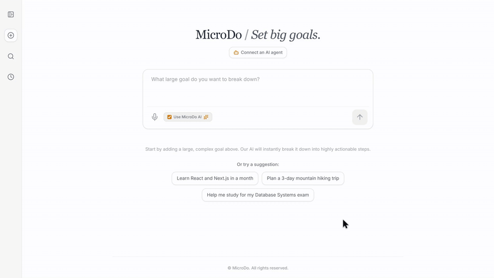

# MicroDo

**Set big goals. Get micro-steps.**

[](https://github.com/davidalexander24/micro-do/actions/workflows/ci.yml)

### 🔗 **Live Demo: [micro-do.vercel.app](https://micro-do.vercel.app/)**

[](docs/demo.mp4)

*Breaking a goal into AI micro-steps, breaking one step down further, checking everything off to 100%, then the Connect an AI agent dialog with the MCP setup for Claude Code and other clients. [▶ Watch full video (MP4)](docs/demo.mp4)*


<br>
MicroDo is a minimalist, AI-powered web application that helps users stop procrastinating by breaking large, complex goals into highly actionable micro-steps, and then breaking any step that still feels too big into even smaller ones.
<br></br>
This full-stack project pairs a React frontend with an Express backend that uses Google Gemini to generate steps, and exposes the same goal list to AI agents through a Model Context Protocol (MCP) server.

## ✨ Features

- **AI-Powered Breakdown:** Enter a large goal and Gemini returns 3 to 6 actionable steps, using structured output (a JSON schema response) instead of parsing free text.
- **Break It Down Further:** Any step can be split into 3 to 5 smaller sub-steps, up to two levels deep. The AI gets the rest of the plan as context so sub-steps stay on the step instead of re-planning the goal.
- **Nested Progress:** Ticking a parent ticks its whole subtree, finishing every sub-step completes the parent, and progress counts the smallest steps. Finishing a goal ends with a small celebration.
- **MCP Server for AI Agents:** Connect Claude Code or any MCP client and it can list, create, break down, complete and delete goals in your list. The app shows a ready-to-paste `claude mcp add` command.
- **Private Lists:** Each browser gets its own list, keyed by a random id that also serves as its MCP key.
- **Voice Input:** Speak a goal instead of typing it (Web Speech API).
- **Built for a Public Demo:** AI requests are rate limited per list and per day with counters stored in MongoDB, a failed database connection is retried on the next request instead of breaking a serverless instance, and a daily cron keeps the free Atlas cluster from pausing.
- **Tested:** 15 API and MCP tests run against an in-memory MongoDB in GitHub Actions on every push.

## 🤖 Connecting an AI Agent (MCP)

Click **Connect an AI agent** in the app to get the command for your own list, which looks like this:

```bash
claude mcp add --transport http microdo https://micro-do.vercel.app/api/mcp --header "Authorization: Bearer <your-list-key>"
```

Then start a new Claude Code session and ask something like *"Add a goal to MicroDo: prepare for my backend interview, and break down the first step."* Switch back to the browser and the goal is there.

| Tool | What it does |
|---|---|
| `list_goals` | Lists goals with nested steps, ids and progress |
| `create_goal` | Creates a goal, with AI steps by default |
| `break_down_step` | Splits one step into AI sub-steps |
| `set_step_completed` | Marks a step done or not done (idempotent) |
| `delete_goal` | Deletes a goal and its steps |

The server is a stateless Streamable HTTP endpoint: each request builds a fresh MCP server scoped to the caller's list, so nothing depends on session state surviving between serverless invocations.

## 🏗️ Architecture

```
frontend/ (React + Vite)           backend/ (Express on Vercel Functions)
  App.jsx  ── fetch + X-Client-Id ──▶ routes/goals.js ─┐
  ConnectAgent.jsx                                     ├─▶ services/goals.js ──▶ MongoDB Atlas
                    MCP clients ── Bearer key ──▶ routes/mcp.js ─┘        │
                                                                          ├─▶ Gemini (structured output)
                                                                          └─▶ services/rateLimit.js
```

The REST routes and the MCP tools are thin layers over one service module, so both behave the same way. Steps are stored as a flat array with `parentId` and `depth`, which keeps updates simple while the UI renders them as a tree.

### REST API

All `/api/goals` requests carry an `X-Client-Id` header identifying the list.

| Method | Path | Description |
|---|---|---|
| `GET` | `/api/goals` | List goals, newest first |
| `POST` | `/api/goals` | Create a goal (`{ title, useAI }`) |
| `POST` | `/api/goals/:goalId/steps/:stepId/breakdown` | Break a step into AI sub-steps |
| `PATCH` | `/api/goals/:goalId/steps/:stepId` | Toggle a step (cascades to sub-steps) |
| `DELETE` | `/api/goals/:id` | Delete a goal |
| `POST` | `/api/mcp` | MCP endpoint (`Authorization: Bearer <list key>`) |
| `GET` | `/api/health` | Health check, called daily by a Vercel cron |

## 🛠️ Tech Stack

**Frontend:**
- React (via Vite)
- Tailwind CSS
- lucide-react, canvas-confetti

**Backend:**
- Node.js & Express.js
- Mongoose (MongoDB Object Modeling)
- Google Gemini (`gemini-2.5-flash-lite`) with JSON schema responses
- Model Context Protocol TypeScript SDK, zod

**Testing & Deployment:**
- Jest, Supertest, mongodb-memory-server
- GitHub Actions (CI)
- Vercel (static frontend, serverless backend functions, cron jobs)
- MongoDB Atlas (Database)

## 🚀 Getting Started (Local Development)

### Prerequisites
- Node.js installed on your machine
- A MongoDB Atlas connection string
- A Google AI Studio API Key

### Installation

1. Clone the repository:
   ```bash
   git clone https://github.com/davidalexander24/micro-do
   cd micro-do
   ```

2. Install dependencies for the **backend**:
   ```bash
   cd backend
   npm install
   ```

3. Install dependencies for the **frontend**:
   ```bash
   cd ../frontend
   npm install
   ```

### Environment Variables

Create a `.env` file in the `backend` directory and add your secret keys:
```env
MONGODB_URI=your_mongodb_atlas_connection_string
GEMINI_API_KEY=your_google_gemini_api_key
# Optional, defaults shown
AI_LIMIT_PER_HOUR=20
AI_LIMIT_PER_DAY=500
```

Create a `.env.local` file in the `frontend` directory pointing at the local backend:
```env
VITE_API_BASE_URL=http://localhost:5001/api
```

### Running the App Locally

1. Start the backend server (from the `/backend` directory):
   ```bash
   npm start
   ```

2. Start the frontend development server (from the `/frontend` directory):
   ```bash
   npm run dev
   ```

3. Open your browser and navigate to `http://localhost:5173`.

### Running the Tests

From the `/backend` directory:
```bash
npm test
```
The tests start an in-memory MongoDB and mock Gemini, so they need no keys or network access beyond the first MongoDB binary download.

---
*Developed by David Alexander - Faculty of Engineering, Universitas Indonesia.*
